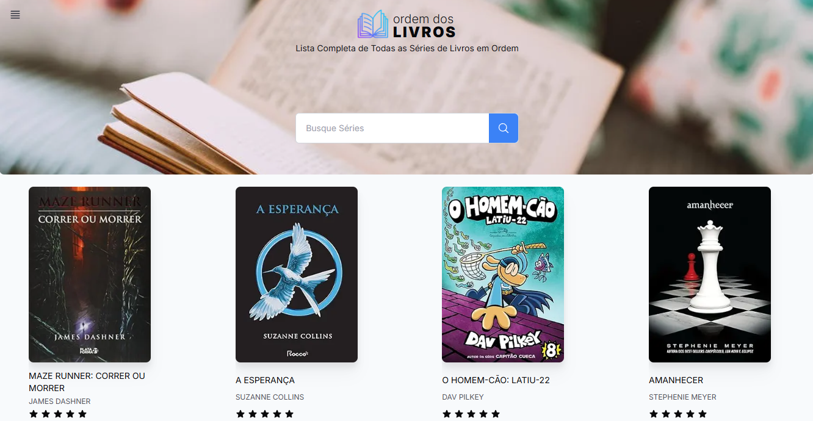
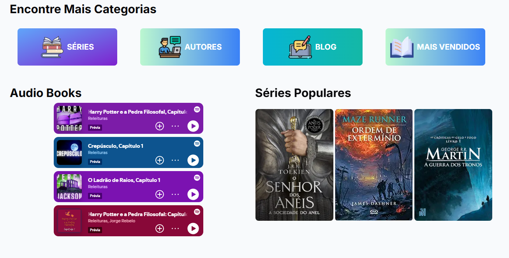
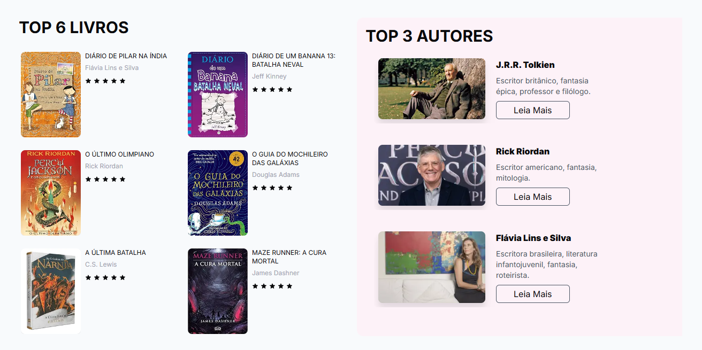

# 📖 Ordem Livro

  

  
  
  
  

---

## 📚 Sobre o projeto

O **Ordem Livro** é uma aplicação moderna e interativa desenvolvida para **amantes da literatura**.  
A plataforma organiza e apresenta informações detalhadas sobre **autores, livros e séries literárias**, permitindo explorar suas **ordens de leitura** — seja cronológica, de publicação ou recomendada.  

Além de ser um guia literário, o projeto também valoriza a **experiência de leitura digital**, com biografias, resenhas e dados completos que facilitam a descoberta de novas obras e escritores.

---

## ✨ Destaques

- 📖 Exibição organizada de livros e séries literárias  
- 👩‍💼 Perfis detalhados de autores com biografias e obras  
- 🔎 Busca rápida e precisa por títulos ou escritores  
- 💬 Resenhas e descrições completas de cada livro  
- 📱 Interface moderna, responsiva e intuitiva  

---

  
  
    
  
    
  

---

## 🚀 Acesse agora

👉 **[Visitar Ordem Livro](https://ordemdoslivros.vercel.app)**  

---

## 🧠 Tecnologias utilizadas

- Next.js  
- TypeScript  
- React  
- Node.js  
- CSS3 / HTML5  

---

  Projeto desenvolvido por <strong>Gabriel Carlos</strong> — veja mais em <a href="https://gabscarlos.vercel.app/" target="_blank">meu portfólio</a> 🎨

